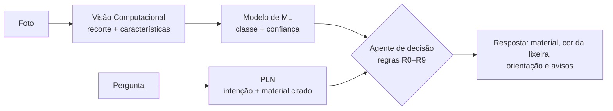

# EcoIA — Separador Inteligente de Resíduos

Projeto Integrador Final de Inteligência Artificial — Afya | UNIMA Maceió (Prof. Icaro Ferreira).

**Artigo (Overleaf):** https://www.overleaf.com/project/6afb8fec0d82ba4ce62ab3fc/share#bf19d9c272566eee19e8ff0d597b2361b828854fb0438972 · **Repositório:** https://github.com/LuizCarvalho-Afya/EcoIA

## Integrantes e responsabilidades

| Nome completo | Responsabilidade |
|---|---|
| Luiz Gustavo Fontes de Carvalho | Machine Learning e Visão Computacional (`src/machine_learning/`, `src/visao_computacional/`) |
| Matheus Cordeiro | PLN e base de perguntas (`src/pln/`, `dados/pln/`) |
| Sanelva Antonio | Decisão, integração, interface, testes e documentação (`src/decisao/`, `src/pipeline.py`, `app.py`, `testes/`, `artigo/`) |

## Problema

Muita gente não sabe em qual lixeira jogar um resíduo, se precisa lavá-lo ou se ele é reciclável. O EcoIA recebe a **foto** de um resíduo e uma **pergunta em português** e responde com o material, a cor da lixeira (Resolução CONAMA nº 275/2001) e a orientação de descarte.

### Público-alvo e objetivos

- **Público-alvo:** pessoas que fazem a coleta seletiva em casa, na escola ou no trabalho e têm dúvidas sobre a lixeira correta ou o preparo do material; também serve como material didático sobre IA aplicada.
- **Objetivo geral:** projetar, implementar e avaliar uma aplicação que integre Machine Learning, Visão Computacional, PLN e tomada de decisão em um único fluxo.
- **Objetivos específicos:** classificar o material do resíduo a partir de uma foto; interpretar a intenção da pergunta; combinar as duas fontes com regras explícitas que tratam incerteza e conflito; avaliar tudo com métricas reais e documentar as limitações.

## Como o projeto atende ao PDF do professor

| Requisito | Onde está | O que faz de verdade |
|---|---|---|
| IA / tomada de decisão (4.1) | `src/decisao/agente.py` | Agente baseado em regras que combina visão e PLN, decide em quem confiar quando divergem e pede nova foto quando a confiança é baixa. Registra cada regra acionada. |
| Machine Learning (4.2) | `src/machine_learning/` | Aprendizado supervisionado (SVM, Random Forest, k-NN, Reg. Logística) sobre três conjuntos de características das imagens do TrashNet (clássicas, rede pré-treinada e combinadas); comparação, ablação e robustez. |
| Visão Computacional (4.3) | `src/visao_computacional/` | Segmentação (Otsu + morfologia), histogramas HSV, HOG, bordas, brilho especular (`extracao.py`) e características de uma rede MobileNetV2 pré-treinada executada com OpenCV DNN (`profundo.py`). |
| PLN (4.4) | `src/pln/` | Normalização, TF-IDF + Reg. Logística para intenção (7 classes), extração de material/objeto por léxico. |
| Integração (4.5) | `src/pipeline.py`, `app.py` | Foto → ML → pergunta → PLN → agente → resposta, em um único fluxo. |

## Arquitetura



## Tecnologias

| Tecnologia | Uso |
|---|---|
| Python | Linguagem principal |
| OpenCV | Segmentação, características clássicas e execução da rede pré-treinada (`cv2.dnn`) |
| MobileNetV2 (ONNX, ImageNet) | Extração de características por transferência de aprendizado |
| scikit-learn | Modelos de ML (SVM, Random Forest, k-NN, Reg. Logística), TF-IDF, métricas |
| NLTK (opcional) | Radicalizador RSLP; há um radicalizador simples embutido como alternativa |
| Pandas, NumPy, Matplotlib | Dados, cálculo e gráficos |
| Streamlit | Interface web |
| pytest | Testes automatizados |

## Estrutura

```
EcoIA/
├── app.py                      # interface Streamlit
├── requirements.txt
├── src/
│   ├── visao_computacional/    # segmentação, características clássicas e profundas (OpenCV)
│   ├── machine_learning/       # dados, treino, avaliação, download do TrashNet
│   ├── pln/                    # pré-processamento, entidades, intenções, treino
│   ├── decisao/                # base de conhecimento e agente
│   ├── pipeline.py             # fluxo integrado
│   ├── constantes.py, tipos.py
├── dados/pln/perguntas.csv     # 211 perguntas rotuladas (escritas pela equipe)
├── notebooks/
├── modelos/                    # modelos treinados (gerados)
├── resultados/{graficos,exemplos}/
├── testes/
└── artigo/main.tex             # artigo IEEE (LaTeX)
```

## Instalação

```bash
python -m venv .venv && source .venv/bin/activate   # Windows: .venv\Scripts\activate
pip install -r requirements.txt
python -c "import nltk; nltk.download('rslp')"      # opcional: radicalizador RSLP
```

Sem o recurso `rslp`, o PLN usa um radicalizador simples embutido. O backend usado fica registrado em `resultados/metricas_pln.json`. Para fixar: `ECOIA_STEMMER=simples` ou `ECOIA_STEMMER=rslp`.

## Execução (reprodutível)

```bash
# 1. Dataset de imagens (não incluído no repositório)
python -m src.machine_learning.baixar_dataset        # ou baixe manualmente em dados/trashnet/

# 1b. Rede pré-treinada MobileNetV2 (ONNX, ~14 MB) para a transferência de aprendizado
python -m src.machine_learning.baixar_modelo         # salva em modelos/mobilenetv2.onnx

# 2. Treinar e avaliar a visão (gera modelos/modelo_visao.joblib, gráficos e métricas)
python -m src.machine_learning.treino --dados dados/trashnet --saida resultados
#    O treino compara 3 conjuntos de características (clássico, profundo, combinado) e usa o melhor.
#    Sem o arquivo da rede, avalia só o clássico. Use --sem-profundo para forçar o clássico.

# 3. Treinar e avaliar o PLN (gera modelos/modelo_pln.joblib, gráficos e métricas)
python -m src.pln.treino_pln --csv dados/pln/perguntas.csv --saida resultados

# 4. Rodar a aplicação
streamlit run app.py

# 5. Testes automatizados
python -m pytest -q
```

As sementes são fixas (42) e as divisões de dados são salvas em `resultados/divisao_dados.csv`.

## Demonstração

Rode `streamlit run app.py`, envie uma foto, escolha ou digite uma pergunta e clique em **Analisar**. A tela mostra a resposta, a imagem e o recorte analisado, as probabilidades por classe, a intenção reconhecida pelo PLN e o painel "Como o agente decidiu" com a regra acionada. Casos de teste do protótipo:

1. **Foto de garrafa PET + "Onde devo jogar isso?"**: Plástico, lixeira vermelha, com orientações de preparo.
2. **Mesma foto + "Posso jogar esse papel na lixeira azul?"**: o agente detecta o conflito (pergunta cita papel, imagem indica plástico com 75%), segue a imagem e responde "Não. Plástico vai na lixeira vermelha, e não na azul" com aviso.
3. **Foto escura e desfocada (falha conhecida)**: o agente só pede outra foto quando a confiança fica abaixo de 0,50. Numa foto escura e desfocada de teste, o classificador deu Papel com 82% e o agente respondeu sem aviso. A confiança não detecta má qualidade de imagem (veja Limitações e o Caso 4 do artigo).

**Vídeo da demonstração:** https://youtu.be/HO2TSEtH4kE (vídeo de 1min45 mostrando o app em funcionamento).

As capturas de tela dessas execuções ficam em `resultados/exemplos/`. Os gráficos e métricas gerados pelo treino ficam em `resultados/graficos/` e `resultados/`; versione essas pastas no GitHub (os modelos `.joblib` e o dataset não são versionados).

## Dados

- **Imagens:** TrashNet (Thung & Yang, Stanford, 2016), https://github.com/garythung/trashnet. Licença: o repositório do TrashNet declara licença MIT (conferido nos metadados do GitHub; o texto completo do arquivo LICENSE deve ser lido no repositório) e pede apenas que o repositório seja citado ao usar o dataset. Mesmo assim, as imagens não estão neste repositório: o download é feito pelo script. O modelo MobileNetV2 (ONNX, pré-treinado no ImageNet) é baixado de fonte pública e também não é redistribuído aqui. Mapeamento: `glass→vidro`, `paper`+`cardboard→papel`, `plastic→plastico`, `metal→metal`, `trash→outros`. Distribuição após o mapeamento: plástico 482, papel 997, vidro 501, metal 410, outros 137 (total 2527).
- **Perguntas (PLN):** `dados/pln/perguntas.csv`, 211 frases escritas pela equipe, em sete intenções (inclui `confirmar_descarte`). Veja a seção de limitações.

## Modelos

- **Visão:** três conjuntos de características comparados: clássico (cor + forma/textura, 1805 atributos), profundo (1000 saídas da MobileNetV2 pré-treinada no ImageNet, sem reajuste da rede) e combinado. Cada um passa por `StandardScaler` e por SVM-RBF (calibrado), Random Forest, k-NN e Reg. Logística; o melhor par é escolhido por F1 macro na validação e avaliado uma vez no teste.
- **PLN:** `TfidfVectorizer` (uni+bigramas) → Regressão Logística. O modelo salvo para a aplicação é treinado com todos os exemplos; as métricas abaixo são de um teste separado.
- **Decisão:** regras R0–R9 documentadas em `src/decisao/agente.py`.

## Resultados

### PLN (execução real, `resultados/metricas_pln.json`, backend `stem-simples`)

Teste com 43 perguntas (211 no total, sete intenções), não usadas no treino:

| Método | Acurácia | F1 macro |
|---|---|---|
| Classe majoritária | 0,16 | 0,04 |
| Regras por palavras-chave | 0,84 | 0,84 |
| TF-IDF + Regressão Logística | 0,74 | 0,73 |

Neste teste o modelo aprendido ficou **abaixo** do baseline de regras. As regras foram escritas pela equipe com o mesmo vocabulário dos exemplos, o que as favorece, e 43 exemplos de teste é pouco (cada erro vale cerca de 2,3 pontos percentuais). Por intenção (F1): confirmar_descarte 0,82, reciclavel 0,77, identificar_material 0,77, onde_descartar 0,73, cor_lixeira 0,73, fora_escopo 0,73, preparo 0,60. Na validação cruzada: LinearSVC 0,790 ± 0,065, Reg. Logística 0,785 ± 0,075, Naive Bayes 0,658 ± 0,095 (o app usa a Reg. Logística por fornecer probabilidades). Erros em `resultados/erros_pln.csv`. Se os números do seu treino forem diferentes (versão do scikit-learn ou radicalizador RSLP instalado), use os seus.

### Visão / ML

**Características clássicas** (execução real da equipe, TrashNet com 2527 imagens, divisão 70/15/15, semente 42):

| Modelo | Acurácia (val.) | F1 macro (val.) | F1 macro (CV 5) |
|---|---|---|---|
| SVM (RBF) | 0,649 | 0,593 | 0,558 ± 0,018 |
| Random Forest | 0,625 | 0,562 | 0,493 ± 0,031 |
| k-NN (k=5) | 0,538 | 0,477 | 0,486 ± 0,030 |
| Reg. Logística | 0,591 | 0,554 | 0,492 ± 0,007 |

No teste, o melhor modelo (SVM) obteve **acurácia 0,661 e F1 macro 0,558**. A distância entre acurácia e F1 sugere desempenho desigual entre classes; confirme em `resultados/metricas_visao.json` (relatório por classe).

**Caso da demonstração:** uma garrafa PET transparente em fundo branco, com recorte correto, foi classificada como papel (59%) com as características clássicas e passou a ser classificada como plástico (75%) com a rede pré-treinada. É um único exemplo; a métrica válida é a do conjunto de teste.

**Rede pré-treinada (transferência de aprendizado)** (execução real da equipe, mesma divisão dos dados):

| Características | Modelo | Acurácia (val.) | F1 macro (val.) | F1 macro (CV 5) | Acurácia (teste) | F1 macro (teste) |
|---|---|---|---|---|---|---|
| Clássicas | SVM (RBF) | 0,649 | 0,593 | 0,558 ± 0,018 | 0,661 | 0,558 |
| Rede pré-treinada | SVM (RBF) | 0,865 | 0,807 | 0,796 ± 0,008 | **0,889** | **0,823** |
| Combinadas | SVM (RBF) | 0,839 | 0,792 | 0,774 ± 0,028 | 0,868 | 0,795 |

O modelo final do app é a rede pré-treinada + SVM. Os demais modelos por conjunto estão em `resultados/comparacao_modelos.csv`. A divisão usa uma única semente e cerca de 380 imagens de teste, sem intervalos de confiança. Por classe no teste do modelo final (380 imagens; valores calculados a partir de `resultados/graficos/matriz_confusao.png`, que reproduzem a acurácia 0,889 e o F1 macro 0,823):

| Classe | n | Precisão | Revocação | F1 |
|---|---|---|---|---|
| Plástico | 73 | 0,93 | 0,85 | 0,89 |
| Papel | 150 | 0,90 | 0,99 | 0,94 |
| Vidro | 76 | 0,87 | 0,88 | 0,88 |
| Metal | 61 | 0,86 | 0,87 | 0,86 |
| Outros | 20 | 0,89 | 0,40 | 0,55 |

A classe `outros` (rejeito) é a mais fraca: só 8 de 20 imagens foram reconhecidas (8 foram classificadas como papel). Os erros entre materiais envolvem sobretudo plástico previsto como vidro (6) e metal previsto como vidro (4). **Ablação das características clássicas** (teste, F1 macro): só cor 0,731; só forma e textura 0,502; todas 0,558. O conjunto completo foi pior que só a cor, provavelmente porque o HOG (1764 dos 1805 atributos) domina o vetor; esta é uma hipótese não testada. A ablação usa o conjunto de teste e não foi usada para escolher o modelo. Comparando com a melhor opção clássica, a rede pré-treinada ainda vence (0,823 contra 0,731).

**Robustez do modelo final** (acurácia / F1 macro no teste com imagens alteradas): original 0,889 / 0,823; mais clara 0,887 / 0,818; mais escura 0,834 / 0,767; ruído gaussiano 0,837 / 0,739; desfoque 0,861 / 0,805. Gráficos em `resultados/graficos/ablacao_caracteristicas.png` e `robustez.png`.

## Limitações

- O TrashNet tem fundo uniforme e iluminação controlada; fotos reais com fundo complexo devem ter desempenho pior.
- A segmentação por Otsu falha em fundos não uniformes (a imagem inteira é usada nesse caso).
- A classe `outros` agrupa itens heterogêneos.
- O conjunto de PLN é pequeno e foi escrito pelos autores, o que limita a variedade e pode favorecer as regras do baseline.
- As orientações de descarte são gerais e variam por município. Este é um protótipo acadêmico, não uma ferramenta oficial.

## Referências

Veja a lista completa em `artigo/main.tex`. Referências: TrashNet (Thung & Yang, repositório GitHub, 2017); CONAMA 275/2001; OpenCV (Bradski, 2000); HOG (Dalal & Triggs, 2005); Otsu (1979); TF-IDF (Salton & Buckley, 1988); RSLP (Orengo & Huyck, 2001); NLTK (Bird et al., 2009); scikit-learn (Pedregosa et al., 2011); Russell & Norvig (2020).
